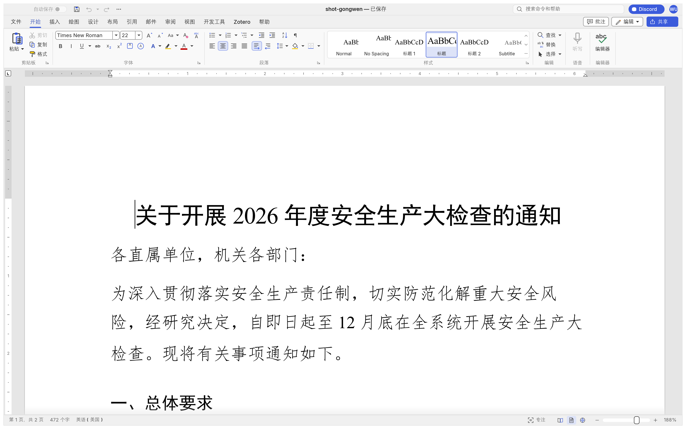
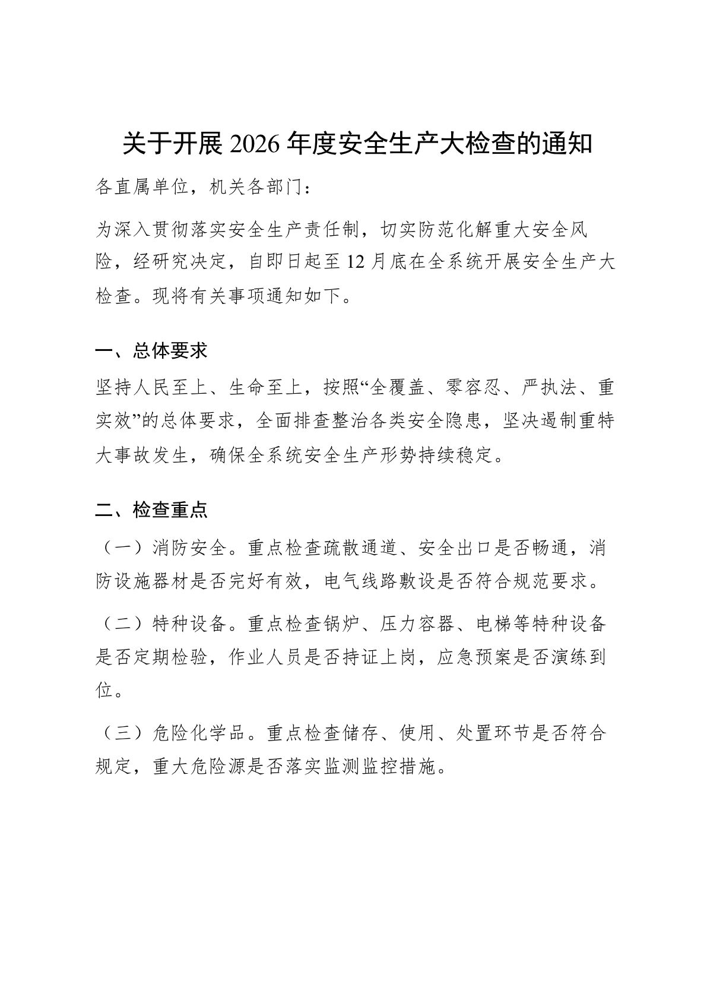
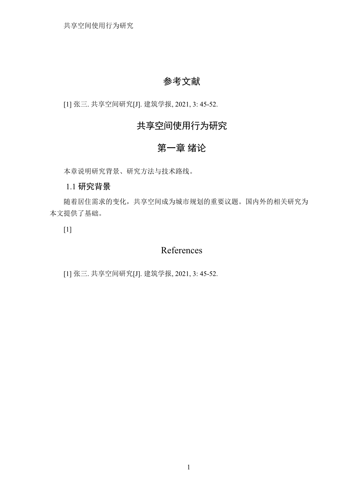
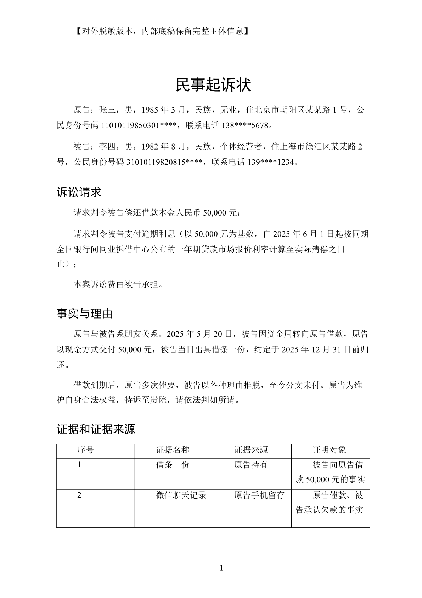
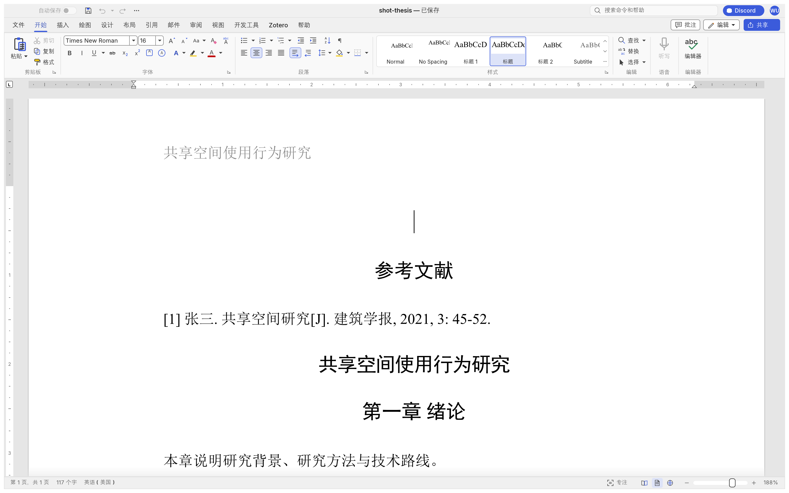
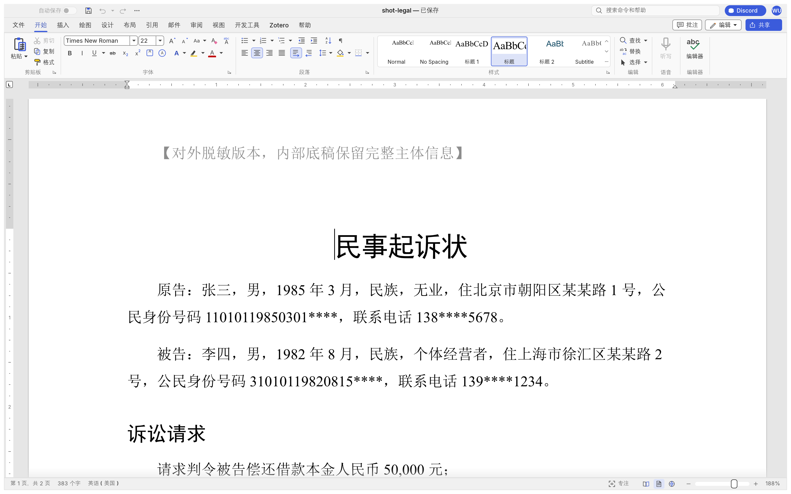

<p align="center">
  
</p>

<h1 align="center">蜻蜓文档 TTWriter</h1>

<p align="center">
  <a href="README.md">English</a> · <b>简体中文</b>
</p>

<p align="center">
  <b>面向中文写作的 WordCraft 发行版</b><br>
  公文、学位论文、法务文书的国标排版，加上中文字数统计与东亚字体 / 语言标记。
</p>

<p align="center">
  <a href="https://www.ttread.cn"></a>
  <a href="https://github.com/storytold/wordcraft"></a>
  
  
  
  
  
</p>



---

## 这是什么

**蜻蜓文档 TTWriter** 是 [WordCraft](https://github.com/storytold/wordcraft) 的**中文发行版**：一份能编译、能跑、能改的完整源码仓库，在上游之上补上中文写作真正需要的那一层。

WordCraft 是一个 Rust 从零写的开源文字处理器，目标是对齐 Microsoft Word 并做得更快、更开放、更可被程序驱动。上游已经带简体中文界面（`zh-hans`）、中文字形、中文断行。我们补的是**写作规范**这一层——国标怎么排、字怎么算、字体怎么写进文件。

| | |
|---|---|
| **完整上游源码** | 不是插件、不是皮肤。`crates/` 下就是 WordCraft 本体，一个仓库 clone 下来就能构建。 |
| **中文字数** | 中文的「字数」按字计，不按空格分词。统计口径对齐 Word 的中文字数（G2）。 |
| **东亚字体与语言** | `w:rFonts/@w:eastAsia`、`w:lang/@w:eastAsia` 正确读写，中文文档在 Word 里打开不掉字体、不掉语言标记。 |
| **四个排版技能** | 公文（GB/T 9704）、学位论文（GB/T 7713 / 7714）、法务文书、以及一份讲清 WordCraft 全部命令的通用技能。 |
| **四套中文默认样式** | 一般文书、公文、论文、法务，一次应用。 |
| **离线** | 不联网、不上传。你的稿子留在你自己的机器上。 |

---

## 装什么、怎么用

### 用预编译版本

三条路，按顺手程度排：

**网页版（免安装）**：浏览器直接开 GitHub Pages 上的 [/app/](https://matou1118.github.io/TTWriter/app/)——完整界面编译成 WebAssembly 在本地跑，文档存在浏览器 IndexedDB 里，不上传服务器。首次加载约 50MB（wasm），之后有缓存。手机浏览器也能用，可「添加到主屏幕」当轻量 APP。

**便携包**：从 [Releases](https://github.com/matou1118/TTWriter/releases)（国内镜像：[AtomGit](https://atomgit.com/matou118/ttwriter/releases)）下载解压即用：双击 `ttwriter.exe` 打开主程序，`wordcraft-cli.exe` 是命令行工具。界面语言（31 种）和文档技能（13 个）都编译在程序里，无需另配。

**保持更新**（离线检查、双源下载、SHA-256 校验）：

```bash
wordcraft-cli update --check                        # 看有没有新版（24 小时缓存）
wordcraft-cli update --install                      # 下载并安装（便携包换目录、MSI 静默装）
wordcraft-cli update --install --install-dir <目录>  # 指定要替换的安装目录
```

便携包的安装方式是**旁路换目录**：新版装到旧版旁边（`wordcraft-<新版>-windows-x64-portable`），旧目录原样保留，确认新版没问题后手动删——绝不自动删用户的东西。

### 从源码构建

```bash
git clone https://github.com/matou1118/TTWriter
cd TTWriter
cargo build --release -p wordcraft
```

需要 Rust 1.95+（`Cargo.toml` 的 `rust-version`）。Windows 上的完整构建配方（GNU 工具链 + MinGW）见 `build.ps1`；一条命令跑完构建、测试、格式检查、技能校验见 `test-all.ps1`。

**中文字体不进仓库**（字体文件一概不进）。中文版官方构建把四款字体当作**可选构建输入**嵌进二进制，所以没装中文字体的机器上也能正常显示中文：

```text
craft-fonts/fonts/manifest.txt   # 连同字体文件，都被 gitignore
./build.ps1                      # 自动带上
```

嵌进去的是：**阿里巴巴普惠体**（黑体，免费商用授权）、**朱雀仿宋**（OFL）、**霞鹜文楷 GB**（OFL）——前三款只在**这台机器没有对应字体时**才顶上，文档指定的字体永远优先。宋体不嵌，Windows/macOS/Linux 都自带。直接 `cargo build` 得到的是上游行为：中文全靠系统字体（Linux 上没有中文字体就靠 Noto CJK / 黑体兜底）。

### 命令行与自动化

每个功能都是命令，界面、快捷键、命令行、控制通道和 MCP 走的是同一套命令。

```bash
wordcraft-cli convert 稿子.docx 稿子.pdf            # 转格式
wordcraft-cli render 稿子.docx page1.png --page 1   # 渲染成图
wordcraft-cli pdf merge 合并.pdf 甲.pdf 乙.pdf       # 合并 PDF；还有 info / rotate / delete / extract
wordcraft-cli commands                              # 列出全部命令
wordcraft-cli mcp                                   # 以 MCP 服务器方式跑，交给 AI 用
```

---

## 中文排版层

### 技能（skills）

放在 `skills/` 下，是给 AI 助手用的操作手册：什么时候用哪条命令、国标要求什么、哪里会踩坑。每个技能都配了可直接运行的 Python 脚本。

| 技能 | 干什么 | 国标 |
|---|---|---|
| [`skills/wordcraft`](skills/wordcraft/) | WordCraft 全部命令的用法、可用性核查和证据台账 | — |
| [`skills/gongwen`](skills/gongwen/) | 公文：通知、请示、报告、函、纪要、批复、意见 | GB/T 9704—2012 |
| [`skills/thesis`](skills/thesis/) | 学位论文：封面、页眉、目录、图表编号、参考文献 | GB/T 7713.1、GB/T 7714—2015 |
| [`skills/legal-docs`](skills/legal-docs/) | 民事起诉状、律师函、法律意见书、合同审查报告 | — |

四个技能都只做**排版**：内容必须是已经定稿的文本，技能不会替你写、编或改一个字。写内容的活交给写作技能。

### 中文模板包（内置）

`file.new` 的 `template` 参数直接认（`wordcraft-cli run --template ×× --save out.docx` 一步出稿），全是占位文本——版式先行，事实你填：

| 模板 id | 用途 | 版式要点 |
|---|---|---|
| `resume-cn` | 中文简历 | 姓名居中、求职意向、教育/工作/技能/自我评价四节 |
| `letter-cn` | 中文信纸 | 称呼顶格、正文缩进两字、此致敬礼、落款右对齐 |
| `timetable` | 课程表 | 6 节次 × 周一到周五表格 + 午休行 |
| `minutes` | 会议纪要 | 标题 + 会议信息表 + 议题四节 |
| `memo` | 便笺 | 标题 + 日期 + 事项 + 底部分隔线 |

另有英文模板 `sample` / `letter` / `resume` / `report`（上游自带）。红头文件用 `wordcraft-cli redhead`（见上文命令行节）。

### 预设（presets）

`presets/` 下四套中文页面与默认样式，是一段可直接跑的脚本：

```bash
wordcraft-cli run --file 稿子.docx --script presets/zh-gongwen.json --save out.docx
```

| 预设 | 用途 |
|---|---|
| `zh-general.json` | 一般中文文书 |
| `zh-gongwen.json` | 公文（版心、字号、行距） |
| `zh-thesis.json` | 学位论文 |
| `zh-legal.json` | 法务文书 |

### 图

| 公文 | 论文 | 起诉状 |
|---|---|---|
|  |  |  |

<table>
<tr>
  <td width="50%"></td>
  <td width="50%"></td>
</tr>
</table>

---

## 相对上游迭代了什么

基线是 WordCraft **v0.9.0**。改动分两类，都写在 [`OPEN-SOURCE-STRATEGY.md`](OPEN-SOURCE-STRATEGY.md) 里。

**给上游的（已整理成 PR，补丁在 [`upstream-prs/`](upstream-prs/)）**

1. **中文字数按字统计** — 原来会把一段中文按空格切开数，字数严重偏少。现在按 Word 的中文字数口径（G2）统计。
2. **`w:lang/@w:eastAsia` 读写** — 中文段落之前丢掉东亚语言标记，在 Word 里拼写检查语言会跑成英语。

**只属于本发行版的**

3. **四个排版技能 + 四套预设** — 见上。
4. **修复公文排版的字体名** — 现代 Windows 上不存在 `仿宋_GB2312`、`楷体_GB2312` 这两个字体名（`simfang.ttf` 的字体名是 `FangSong`/`仿宋`），写成 GB2312 名字会**静默回退成黑体**，公文的仿宋/楷体区分就没了。现在按候选顺序解析真机上真实存在的字体名。
5. **修复论文脚本的命令顺序** — 插入页眉会把光标移进页眉，此后主文本命令会失败。现在目录与参考文献排在页脚、页眉之前。

已知限制，写在技能文档里而不是藏着：

- **没有中文拼写/语法校对**。WordCraft 的校对只有英、俄、波、葡、意几种语言，中文校对尚未实现，本发行版也没有假装有。
- **GB/T 7714 的条目模板缺 `{issue}`（期号）槽位**，期刊论文的期号需要手工补。
- **参考文献默认标题是英文 `References`**，用 `references.bibliography` 的 `title` 参数改成「参考文献」。
- **方正小标宋简体**（公文标题规定的 2 号小标宋）不是 Windows 自带字体，机器上没有时回退为**宋体**并提示（程序内置的替换表也把方正小标宋简体指向宋体——标题是宋体一类，不是黑体）。

---

## 和上游的关系

这是一个**薄发行版**：与上游的分歧尽量少，通用改进往上游提 PR。

- 仓库里是**完整上游源码**加我们的补丁。合并上游很容易：补丁只有两处，都在小函数里，`git apply --check` 在 v0.9.0 上是干净的。
- 程序内部标识（crate 名、二进制名 `wordcraft.exe`、配置目录、包名 `ai.storyteller.wordcraft`）**保持不变**，这样和上游同步时不会到处冲突。**不同的只有显示名**：窗口标题、关于对话框、exe 属性、安装包条目，一共二十几行。
- 我们**不使用任何 ArtCraft 标识**，也不代表 ArtCraft 或向 ArtCraft 提交的代码。按上游商标条款，本仓库只在正文里以平文本说明「基于 WordCraft（ArtCraft 团队）」。品牌图案也全部换成了自己的（见 [`ATTRIBUTION.md`](ATTRIBUTION.md)）。
- 上游代码许可是 MIT OR Apache-2.0，这个许可不变。本仓库自己新增的内容（技能、预设、构建与文档）是 Apache-2.0。

欢迎提 Issue / PR。上游有一份很好的开发守则 [`AGENTS.md`](AGENTS.md)，本仓库照办；贡献流程见 [`CONTRIBUTING.md`](CONTRIBUTING.md)，安全问题见 [`SECURITY.md`](SECURITY.md)。

---

## 官网与出处

- 官网 / 作品集：**[www.ttread.cn](https://www.ttread.cn)**（蜻蜓伴读 · 码头哥）
- 上游：**[storytold/wordcraft](https://github.com/storytold/wordcraft)** — WordCraft 由 ArtCraft 团队开发，MIT OR Apache-2.0

## 致谢

- **ArtCraft 团队与 WordCraft 的全部贡献者**：这个从零写起的 Rust 文字处理器是本项目全部工作的地基。上游把 WordCraft 从架构到 OOXML 兼容都做得很扎实，我们才能在它上面只补一层。
- **WordCraft 的中文界面（`zh-hans`）来自上游**，不是这里做的。
- 本项目用到的开放字体（Inter、JetBrains Mono、Source Sans/Serif）、断字与拼写词表，作者与许可逐条列在 [`ATTRIBUTION.md`](ATTRIBUTION.md)。
- 排名不分先后的上游数据来源：ECMA-376 / ISO 29500（OOXML）等公开规范。

版本变更与感谢逐版记录见 [`CHANGELOG.md`](CHANGELOG.md)。

## 许可

- 本仓库代码：**MIT OR Apache-2.0**（[`LICENSE-MIT`](LICENSE-MIT)、[`LICENSE-APACHE`](LICENSE-APACHE)），与上游一致。
- 本仓库新增内容（`skills/`、`presets/`、`tools/`、文档）：**Apache-2.0**。
- 素材与第三方内容：见 [`ATTRIBUTION.md`](ATTRIBUTION.md)。
